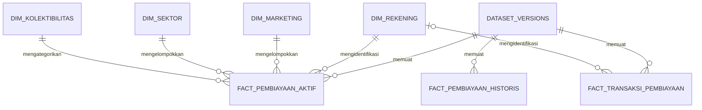

# DATA_ARCHITECTURE.md
# Arsitektur Data — BI BMT Lubuk Malako

- Versi: 1.0
- Tanggal: 21 Oktober 2026
- Aplikasi: Python + Streamlit
- Database lokal terverifikasi: MySQL 8.4.3 / InnoDB melalui Laragon
- Nama database lokal: bi_bmt
- Status: Rancangan umum; pemuatan kandidat aktif telah diimplementasikan dan diuji
- Acuan: PRD.md, DESIGN.md, dan AGENTS.md

Dokumen ini menjelaskan sumber, pemetaan, KPI, rancangan data mart,
proses ETL, serta validasi data.

Database lokal kini memiliki 15 tabel InnoDB setelah penerapan satu fakta historis
yang diotorisasi pada 3 November 2026. Pemuatan kandidat aktif menggunakan
skema existing dan didokumentasikan di [ETL_ACTIVE.md](ETL_ACTIVE.md).
Layanan preview/publikasi aktif dan pembaca pointer dashboard tersedia.
Pemeriksaan baca-saja 3 November 2026: publikasi aktif 1 menunjuk dataset 34,
kamus 33. ID ini merupakan hasil observasi, bukan konfigurasi/hardcode aplikasi.
Lihat [PUBLICATION_ACTIVE.md](PUBLICATION_ACTIVE.md).
Prasyarat historis (satu tabel tambahan, ETL, publikasi terpisah dan analisis)
telah diimplementasikan dan diuji pada DB pengujian. Skema dan load produksi
terbaru menghasilkan kandidat historis 53 ready, rekonsiliasi dan preview lulus;
belum dipublikasikan. Lihat [HISTORICAL_PRODUCTION_CANDIDATE.md](HISTORICAL_PRODUCTION_CANDIDATE.md).
Lihat [HISTORICAL_ANALYSIS.md](HISTORICAL_ANALYSIS.md) untuk aturan dan langkah operator.
Audit terbaru [HISTORICAL_READINESS.md](HISTORICAL_READINESS.md) mempertahankan
seluruh record historis. Konfirmasi BMT 3 November 2026 menyatakan baris identik
merupakan pembiayaan berbeda; audit kesamaan dan lineage tetap disimpan pada
aturan v3. Tidak ada ID kontrak untuk klaim kontrak unik. Record tenor 300
tidak dikecualikan dari BI hanya karena filter eksperimen model. Penulisan kandidat
historis sudah diotorisasi dan selesai; pointer publikasi historis belum dibuat.
ETL transaksi serta integrasi model belum tercakup. Bagian rancangan berikut tetap menjadi acuan,
bukan klaim bahwa seluruh data mart sudah selesai.

---

## 1. Tujuan Arsitektur

Arsitektur data dirancang untuk:

1. Mempertahankan sumber asli BMT.
2. Memisahkan pembiayaan aktif, historis, dan transaksi.
3. Menghasilkan indikator yang dapat ditelusuri.
4. Menghubungkan nama marketing dan sektor secara terkendali.
5. Menyimpan versi data dan riwayat penerbitan.
6. Mencegah penggandaan saldo akibat penggabungan data.
7. Mendukung dashboard tanpa bergantung pada kesiapan model.
8. Menyediakan dasar integrasi model yang terpisah dari perhitungan BI.

Data pembiayaan bersumber dari ekspor Excel.
Nama SQLRESULT tidak berarti aplikasi BI terhubung langsung
ke database operasional BMT.

---

## 2. Teknologi dan Tanggung Jawab

| Komponen | Teknologi | Tanggung jawab |
|---|---|---|
| Pembacaan sumber | Python dan Pandas | Membaca Excel |
| Pembaca XLS | xlrd | Mendukung format XLS asli |
| Pembaca XLSX | OpenPyXL | Mendukung format XLSX |
| Transformasi | Python | Parsing, pemetaan, pengayaan, validasi |
| Penyimpanan | MySQL/MariaDB | Metadata, dimensi, fakta, publikasi |
| Layanan database lokal | Laragon | Menjalankan MySQL/MariaDB |
| Penyajian | Streamlit dan Plotly | Dashboard dan interaksi |
| Pengujian | pytest | Pemeriksaan logika dan integritas |

Versi engine database dan library dicatat saat implementasi.

Gunakan fitur SQL yang didukung engine terpasang.
Jangan mengandalkan constraint tanpa memeriksa dukungannya.

---

## 3. Sumber dan Lokasi File

| File lokal | Lokasi | Peran |
|---|---|---|
| 1.XLS | data/raw/aktif/ | Sumber utama pembiayaan aktif |
| SQLRESULT.XLS | data/raw/historis/ | Historis pembiayaan selesai |
| SQLRESULT1.XLS | data/raw/pendukung/ | Kamus marketing/sektor dan pembanding |
| Lancar.XLS | data/raw/transaksi/ | Transaksi pendukung |
| Kurang Lancar.XLS | data/raw/transaksi/ | Transaksi pendukung |
| Diragukan.XLS | data/raw/transaksi/ | Transaksi pendukung |
| Macet.XLS | data/raw/transaksi/ | Transaksi pendukung |
| SQLRESULT2 atau SQLRESULT 2 | data/raw/pendukung/ | Arsip opsional |

Nama file transaksi boleh mempertahankan nama asli.
Pemilihan sumber dilakukan melalui konfigurasi atau formulir unggah.

### Keputusan sumber

- Saldo, tunggakan pokok, dan kolektibilitas aktif memakai file 1.
- Historis penyelesaian memakai SQLRESULT.
- SQLRESULT1 digunakan untuk kamus kode–nama.
- Transaksi disimpan terpisah dari posisi aktif.
- SQLRESULT2 tidak masuk ETL utama.
- File pendukung tidak digunakan sebagai fallback saldo secara diam-diam.
- Beberapa ekspor aktif tidak dijumlahkan sebagai satu portofolio.

---

## 4. Temuan Pemeriksaan Awal

| Sumber | Baris | Kolom |
|---|---:|---:|
| SQLRESULT | 3.709 | 24 |
| File 1 | 427 | 66 |
| SQLRESULT1 | 427 | 69 |
| Lancar | 6.386 | 25 |
| Kurang Lancar | 115 | 25 |
| Diragukan | 48 | 25 |
| Macet | 30 | 25 |

Temuan tambahan:

- File 1 memiliki 427 nomor rekening terisi dan unik.
- Gabungan transaksi memiliki 6.579 baris.
- Sebanyak 420 rekening aktif ditemukan pada gabungan transaksi.
- SQLRESULT historis tidak memiliki nomor rekening.
- SQLRESULT1 tidak memiliki nomor rekening.
- Pemetaan kode marketing dan sektor saat ini tidak ambigu.

Angka tersebut merupakan hasil pemeriksaan berkas saat ini.
Aplikasi harus menghitung ulang saat menerima versi baru.

Tidak ditemukan transaksi bukan bukti tidak pernah membayar.
Keunikan rekening pada versi sekarang tidak menjamin semua unggahan
berikutnya akan memiliki keunikan yang sama.

---

## 5. Periode dan Tanggal

Periode permintaan data tambahan kepada BMT:

Agustus 2025–Juli 2026.

Pisahkan metadata berikut:

| Metadata | Pengertian |
|---|---|
| requested_period_start/end | Periode yang diminta kepada BMT |
| observed_date_min/max | Rentang tanggal yang ditemukan dalam file |
| position_date | Tanggal kondisi saldo/kolektibilitas |
| position_date_status | Status kepastian tanggal posisi |
| export_date | Tanggal ekspor jika diketahui |
| export_period_text | Keterangan ekspor jika hanya bulan/tahun diketahui |
| uploaded_at | Waktu file masuk aplikasi |
| published_at | Waktu versi diaktifkan |

Aturan:

- Tanggal posisi yang tidak diketahui disimpan NULL.
- Gunakan status unknown, inferred, atau confirmed.
- inferred hanya mencatat hasil dugaan analitis, bukan konfirmasi.
- Fungsi yang membutuhkan posisi pasti menggunakan confirmed.
- Jangan mengisi tanggal posisi dari tanggal unggah.
- Jangan menggunakan tanggal transaksi maksimum sebagai posisi otomatis.
- Periode permintaan tidak membuktikan transaksi lengkap.
- Periode permintaan tidak membuktikan tersedia 12 snapshot.
- Kontrak lama tetap dipertahankan jika terdapat dalam sumber aktif.

Tanggal bisnis disimpan sebagai DATE.
Timestamp sistem disimpan dengan konvensi UTC dan ditampilkan dalam WIB.

---

## 6. Grain dan Batas Identitas

Grain adalah makna satu baris pada setiap tabel.

| Data | Grain |
|---|---|
| Aktif | Satu rekening pembiayaan pada satu versi dataset |
| Historis | Satu record pembiayaan selesai pada satu versi dataset |
| Transaksi | Satu baris transaksi sumber dalam satu versi dataset |
| Kamus marketing | Satu kode marketing pada satu versi kamus |
| Kamus sektor | Satu kode sektor pada satu versi kamus |
| Scoring | Satu record aktif untuk satu versi model |

### Nomor rekening

- Disimpan sebagai teks.
- Bukan angka untuk operasi matematika.
- Bukan identitas nasabah.
- Bukan fitur model.
- Format asli dan hasil normalisasi harus dapat ditelusuri.
- Nol awal atau digit hilang tidak boleh ditebak.

Normalisasi hanya dilakukan berdasarkan bentuk sumber yang diperiksa.
Jika sel Excel bertipe numerik, representasinya harus diperiksa agar
konversi tidak mengubah identitas atau menambahkan notasi ilmiah.

### Historis anonim

SQLRESULT tidak dihubungkan dengan aktif atau transaksi berdasarkan:

- kesamaan nominal;
- tenor;
- tanggal;
- urutan baris;
- composite key yang tidak terverifikasi.

Gunakan ID internal historis untuk penelusuran dalam versi tersebut.

### Transaksi

Rekening dan tanggal dapat berulang.
Kombinasi rekening + tanggal tidak dianggap ID transaksi unik.

Gunakan ID internal serta file, sheet, dan nomor baris asal.

---

## 7. Lapisan Data

### 7.1 Raw

Lokasi: data/raw/

Berisi sumber asli tanpa perubahan.

- Tidak diedit saat cleaning.
- Tidak ditimpa oleh hasil ETL.
- Tidak dipublikasikan ke repository publik.

### 7.2 Staging

Berisi hasil pembacaan dengan perubahan minimal:

- metadata file;
- nama sheet;
- nomor baris Excel;
- nilai sumber;
- hasil parsing;
- status pemeriksaan.

Staging dapat disimpan dalam tabel khusus atau berkas kerja terkontrol.
Implementasi harus mempertahankan lineage ke sumber asli.

### 7.3 Data mart

Berisi data bertipe dan tervalidasi:

- dimensi;
- fakta aktif;
- fakta historis;
- fakta transaksi;
- metadata versi.

### 7.4 Penyajian

Berisi query atau view yang dipakai layanan aplikasi:

- KPI;
- daftar pemantauan;
- agregasi marketing;
- agregasi sektor;
- analisis historis.

Data mart menyimpan fakta dasarnya.
Persentase dihitung dari numerator dan denominator sesuai filter.

---

## 8. Pemetaan File Aktif

Sumber: data/raw/aktif/1.XLS

| Kolom sumber | Field internal | Tipe rencana | Penggunaan |
|---|---|---|---|
| no_rekening | account_number | VARCHAR(100) | Identitas rekening |
| tgl_realisasi | realization_date | DATE | Informasi dan analisis kontrak |
| tgl_jatuh_tempo | recorded_maturity_date | DATE | Jatuh tempo yang tercatat |
| bi_jangka_waktu | recorded_tenor | DECIMAL(10,2) | Tenor tercatat |
| satuan_waktu_angsuran | installment_unit_code | VARCHAR(20) | Satuan angsuran mentah |
| jml_pinjaman | original_principal | DECIMAL(20,2) | Nominal awal |
| saldo_nominatif | outstanding_principal | DECIMAL(20,2) | Sisa pokok |
| tunggakan_pokok | overdue_principal | DECIMAL(20,2) | Tunggakan pokok |
| kolektibilitas | collectibility_code | VARCHAR(20) | Kategori kualitas |
| kode_group1 | marketing_code | VARCHAR(30) | Hubungan kamus marketing |
| kode_group2 | sector_code | VARCHAR(30) | Hubungan kamus sektor |
| bi_margin | recorded_margin | DECIMAL(18,6) | Parameter margin mentah |
| sisa_margin | remaining_margin | DECIMAL(20,2) | Nilai tercatat, bukan pokok |
| akad | contract_type_code | VARCHAR(30) | Kode akad |
| jenis_pinjaman | financing_type_code | VARCHAR(30) | Jenis pembiayaan |
| type_pinjaman | financing_subtype_code | VARCHAR(30) | Atribut sumber |

Ketentuan:

- recorded_maturity_date belum otomatis berarti jatuh tempo awal.
- installment_unit_code tidak otomatis menjelaskan satuan tenor.
- recorded_margin tidak dibagi 100 berdasarkan nama kolom saja.
- original_principal berbeda dari outstanding_principal.
- remaining_margin tidak dimasukkan ke KPI outstanding pokok.

Kolom lain dipertahankan pada raw/staging.
Masukkan ke data mart hanya jika memiliki kebutuhan dan definisi jelas.

### Field yang ditunda penggunaannya

- angsuranke.
- tunggakan_basil sebagai indikator tunggakan margin.
- kode lain yang maknanya belum terverifikasi.
- angsuran_pokok sebagai jadwal aktual sebelum maknanya dipastikan.

Penundaan field tidak menggagalkan KPI pokok yang valid.

---

## 9. Pemetaan Kamus

Sumber: data/raw/pendukung/SQLRESULT1.XLS

| Kolom kode | Kolom deskripsi | Tujuan |
|---|---|---|
| kode_group1 | deskripsi_group1 | dim_marketing |
| kode_group2 | deskripsi_group2 | dim_sektor |

Proses:

1. Pilih pasangan kode dan deskripsi.
2. Rapikan spasi tanpa mengubah makna.
3. Hilangkan pengulangan pasangan yang identik.
4. Periksa satu kode dengan beberapa deskripsi.
5. Simpan kamus sebagai versi.
6. Hubungkan dengan kode pada file aktif.

Join harus many-to-one.

Sesudah join:

- jumlah record aktif tetap;
- total outstanding tetap;
- total tunggakan tetap;
- total nominal awal tetap.

Jika kode belum terpetakan:

- pertahankan record aktif;
- pertahankan kode sumber;
- gunakan label “Belum terpetakan”;
- catat temuan.

Nama dan kode tidak boleh ditempel berdasarkan urutan baris.

---

## 10. Pemetaan Historis

Sumber: data/raw/historis/SQLRESULT.XLS

| Kolom sumber | Field internal | Penggunaan |
|---|---|---|
| tgl_realisasi | realization_date | Tahun realisasi dan durasi |
| tgl_jatuh_tempo | original_maturity_date | Jatuh tempo awal |
| tgl_akhir_trans | completion_date | Tanggal penyelesaian |
| jml_pinjaman | original_principal | Nominal pembiayaan |
| bi_jangka_waktu | recorded_tenor | Tenor tercatat |
| bi_suku_bunga | recorded_margin_parameter | Parameter sumber |

Field turunan:

| Field | Definisi |
|---|---|
| contract_duration_days | original_maturity_date - realization_date |
| completion_delay_days | max(0, completion_date - original_maturity_date) |
| target_late | 1 jika completion_date > original_maturity_date, selain itu 0 |
| historical_analysis_eligible | Status kelayakan analisis tanggal |

Field turunan hanya dibentuk setelah tanggal dinyatakan valid.

Tanggal kosong atau tidak valid menghasilkan status tidak memenuhi syarat,
bukan target 0.

Pemetaan recorded_margin_parameter ke fitur model memerlukan
kesesuaian dengan pipeline eksperimen.

Saldo akhir historis tidak digunakan sebagai saldo aktif.

---

## 11. Pemetaan Transaksi

Sumber: empat file pada data/raw/transaksi/

| Kolom sumber | Field internal | Catatan |
|---|---|---|
| no_rekening | account_number | Kandidat hubungan rekening |
| tgl_trans | transaction_date | Tanggal transaksi |
| kode_trans | transaction_code | Makna perlu pemetaan |
| my_kode_trans | internal_transaction_code | Makna perlu pemetaan |
| kode | export_group_code | Kelompok laporan asal |
| deskripsi | export_group_description | Deskripsi kelompok asal |
| kolektibilitas | recorded_collectibility_code | Nilai pada baris transaksi |
| plafond | recorded_disbursement_amount | Nilai sumber, klasifikasi belum diasumsikan |
| pokok_trans | principal_transaction_amount | Nilai transaksi pokok |
| basil_trans | margin_transaction_amount | Nilai transaksi margin/bagi hasil |
| denda_trans | penalty_transaction_amount | Nilai transaksi denda |
| admin_trans | administration_transaction_amount | Nilai administrasi |
| disc_pokok | principal_discount_amount | Diskon pokok tercatat |
| disc_basil | margin_discount_amount | Diskon margin tercatat |
| kode_group1 | recorded_marketing_code | Kode pada transaksi |
| kode_group2 | recorded_sector_code | Kode pada transaksi |

Aturan:

- Pertahankan tanda nominal.
- Jangan menganggap seluruh pokok_trans sebagai pembayaran sebelum
  kode transaksi dipahami.
- Jangan menambahkan nominal transaksi ke outstanding.
- Jangan mengganti kolektibilitas aktif dengan kode kelompok ekspor.
- Marketing/sektor transaksi tidak otomatis sama dengan penanggung jawab
  pada posisi aktif.

Rekening transaksi yang tidak ada pada file aktif tetap disimpan.
Ketiadaannya tidak membuktikan kontrak sudah lunas.

---

## 12. Definisi KPI

Semua KPI aktif memakai satu versi aktif terbit.
Implementasi layanan bersama dan CLI baca-saja tersedia pada
[kpi_definitions.md](kpi_definitions.md), termasuk perilaku filter, unknown,
penyebut nol, serta hasil rekonsiliasi aktual. Ini belum merupakan integrasi UI.

| KPI | Perhitungan |
|---|---|
| Jumlah rekening aktif | COUNT record rekening valid pada cakupan |
| Total nominal awal | SUM(original_principal) |
| Total outstanding | SUM(outstanding_principal) |
| Total tunggakan pokok | SUM(overdue_principal) |
| Jumlah KL/D/M | COUNT record dengan kategori KL, D, M |
| Outstanding KL/D/M | SUM(outstanding_principal) untuk kategori KL, D, M |
| NPF | Outstanding KL/D/M / total outstanding × 100% |
| Porsi outstanding kelompok | Outstanding kelompok / total cakupan × 100% |
| NPF kelompok | Outstanding KL/D/M kelompok / outstanding kelompok × 100% |
| Tingkat terlambat historis | Jumlah target_late=1 / jumlah historis eligible × 100% |

Ketentuan:

- Tunggakan bukan pembilang NPF.
- Tunggakan tidak ditambahkan ke outstanding.
- NPF gabungan bukan rata-rata NPF kelompok.
- Gunakan cakupan dan filter yang sama.
- Penyebut nol menghasilkan status tidak dapat dihitung.
- Unknown tidak dikategorikan sebagai Lancar.
- Hasil parsial diberi konteks, tidak disebut total portofolio penuh.
- Saldo tidak dijumlahkan lintas versi atau tanggal posisi.

Acuan NPF 5% merupakan acuan analisis.
Tidak digunakan untuk menyimpulkan kesehatan keseluruhan lembaga.

---

## 13. Aturan Daftar Pemantauan

Perlu Ditinjau:

overdue_principal > 0
ATAU collectibility_code termasuk KL, D, M.

Urutan awal:

1. overdue_principal menurun.
2. ID internal meningkat untuk urutan konsisten saat nominal sama.

Setiap record muncul sekali meskipun memiliki beberapa alasan.

Alasan disimpan atau dihitung secara eksplisit:

- mempunyai tunggakan pokok;
- kategori Kurang Lancar;
- kategori Diragukan;
- kategori Macet.

Skor model menjadi kolom tambahan jika tersedia.
Tidak ada formula bobot gabungan tanpa evaluasi.

---

## 14. Rancangan Tabel Administrasi

### app_users

Akun aplikasi.

Field utama:

- user_id: BIGINT, primary key.
- username: VARCHAR(100), unique.
- password_hash: VARCHAR(255), jika menggunakan autentikasi lokal.
- display_name: VARCHAR(150).
- is_active: BOOLEAN.
- created_at: DATETIME.

Jika memakai penyedia autentikasi eksternal, rancangan kredensial
disesuaikan tanpa menyimpan password plaintext.

### app_user_roles

- user_id: foreign key app_users.
- role_code: executive atau admin.
- Primary key gabungan user_id dan role_code.

Satu akun dapat memiliki dua role jika diberikan eksplisit.

### source_files

Mencatat file asli.

- source_file_id: primary key.
- original_filename.
- stored_path.
- file_sha256.
- byte_size.
- uploaded_by.
- uploaded_at.

Fingerprint digunakan mendeteksi unggahan berulang.
File yang sama tidak otomatis menjadi periode baru.

### dataset_versions

Mencatat satu versi dataset.

- dataset_version_id: primary key.
- dataset_kind: active, historical, transactions, atau reference.
- report_name.
- requested_period_start.
- requested_period_end.
- observed_date_min.
- observed_date_max.
- position_date: nullable.
- position_date_status.
- export_date: nullable.
- export_period_text: nullable.
- scope_description.
- schema_version.
- mapping_version.
- validation_rule_version.
- status.
- created_at.

### dataset_sources

Menghubungkan dataset dengan file sumber.

- dataset_version_id.
- source_file_id.
- source_role.
- sheet_name.

Satu dataset transaksi dapat memakai empat file.

### validation_findings

- finding_id.
- dataset_version_id.
- source_file_id: nullable.
- source_row_number: nullable.
- field_name: nullable.
- rule_code.
- severity: blocking, warning, information.
- message.
- affected_function.
- created_at.

Hindari menyalin informasi sensitif yang tidak diperlukan ke pesan.

### dataset_publications

Riwayat penerbitan.

- publication_id.
- dataset_version_id.
- reference_dataset_version_id: nullable.
- published_by.
- published_at.
- previous_publication_id: nullable.
- notes.

Publikasi aktif mencatat versi kamus yang digunakan.

### current_publications

Pointer sumber yang sedang digunakan.

- dataset_kind: primary key.
- publication_id: foreign key.

Perubahan pointer dilakukan dalam transaksi database.
Versi aktif dan historis tidak saling menimpa.

---

## 15. Rancangan Dimensi

### dim_marketing

- marketing_id: primary key.
- reference_dataset_version_id.
- marketing_code.
- marketing_name.
- mapping_status.

Unique:

(reference_dataset_version_id, marketing_code).

### dim_sektor

- sector_id: primary key.
- reference_dataset_version_id.
- sector_code.
- sector_name.
- mapping_status.

Unique:

(reference_dataset_version_id, sector_code).

Kamus dibuat immutable per versi.
Perubahan nama membuat versi referensi baru, tidak mengubah arti
publikasi sebelumnya secara diam-diam.

### dim_kolektibilitas

- collectibility_id: primary key.
- collectibility_code: unique.
- collectibility_name.
- display_order.
- is_npf_category: nullable untuk unknown.

Nilai:

- L: Lancar.
- KL: Kurang Lancar.
- D: Diragukan.
- M: Macet.
- UNKNOWN: Tidak diketahui.

UNKNOWN bukan Lancar dan tidak otomatis diberi flag NPF false.

### dim_tanggal

- date_key: INT, primary key, format YYYYMMDD.
- full_date: DATE, unique.
- day_of_month.
- month_number.
- month_name.
- quarter_number.
- year_number.
- day_of_week.

Digunakan sebagai role-playing dimension untuk:

- realisasi;
- jatuh tempo;
- selesai;
- transaksi;
- posisi jika diketahui.

Tanggal tidak diketahui memakai foreign key NULL.
Jangan membuat tanggal palsu untuk memenuhi relasi.

### dim_rekening

- account_id: primary key.
- source_system_code.
- account_number: VARCHAR(100).
- public_code: VARCHAR(100), unique.
- created_at.

Unique:

(source_system_code, account_number).

Dimensi ini mengidentifikasi rekening dalam sistem sumber.
Tidak menyatakan identitas nasabah atau menjamin kesinambungan kontrak
jika rekening ternyata digunakan kembali.

Rekening transaksi yang tidak ditemukan pada file aktif tetap
dapat memiliki dim_rekening.

---

## 16. Rancangan Tabel Fakta

### fact_pembiayaan_aktif

Grain: satu rekening pada satu versi dataset aktif.

Field utama:

- active_fact_id: primary key.
- dataset_version_id.
- account_id.
- marketing_id.
- sector_id.
- collectibility_id.
- realization_date_key: nullable.
- maturity_date_key: nullable.
- original_principal: DECIMAL(20,2).
- outstanding_principal: DECIMAL(20,2).
- overdue_principal: DECIMAL(20,2).
- remaining_margin: DECIMAL(20,2), nullable.
- recorded_margin: DECIMAL(18,6), nullable.
- recorded_tenor: DECIMAL(10,2), nullable.
- installment_unit_code: nullable.
- recorded_marketing_code.
- recorded_sector_code.
- recorded_collectibility_code.
- contract_type_code: nullable.
- financing_type_code: nullable.
- financing_subtype_code: nullable.
- contract_duration_days: nullable.
- model_input_status.
- source_file_id.
- source_sheet.
- source_row_number.

Unique:

(dataset_version_id, account_id).

Jika sumber berisi rekening duplikat, jangan memakai UPSERT yang
menimpa record tanpa pemeriksaan.

Field nominal yang tidak valid ditangani pada staging/validasi.
Jangan memaksakan nol untuk memenuhi kolom wajib.

### fact_pembiayaan_historis

Grain: satu record historis pada satu versi.

Field utama:

- historical_fact_id: primary key.
- dataset_version_id.
- realization_date_key: nullable.
- original_maturity_date_key: nullable.
- completion_date_key: nullable.
- original_principal: DECIMAL(20,2), nullable.
- recorded_tenor: DECIMAL(10,2), nullable.
- recorded_margin_parameter: DECIMAL(18,6), nullable.
- contract_duration_days: nullable.
- completion_delay_days: nullable.
- target_late: nullable.
- historical_analysis_eligible.
- exclusion_reason: nullable.
- source_file_id.
- source_sheet.
- source_row_number.

Tidak memiliki foreign key rekening yang direka.

Unique lineage:

(dataset_version_id, source_file_id, source_sheet, source_row_number).

### fact_transaksi_pembiayaan

Grain: satu baris transaksi sumber dalam satu versi transaksi.

Field utama:

- transaction_fact_id: primary key.
- dataset_version_id.
- account_id: nullable jika rekening gagal diparsing.
- transaction_date_key: nullable.
- transaction_code.
- internal_transaction_code.
- export_group_code.
- export_group_description.
- recorded_collectibility_code.
- recorded_marketing_code.
- recorded_sector_code.
- recorded_disbursement_amount: DECIMAL(20,2), nullable.
- principal_transaction_amount: DECIMAL(20,2), nullable.
- margin_transaction_amount: DECIMAL(20,2), nullable.
- penalty_transaction_amount: DECIMAL(20,2), nullable.
- administration_transaction_amount: DECIMAL(20,2), nullable.
- principal_discount_amount: DECIMAL(20,2), nullable.
- margin_discount_amount: DECIMAL(20,2), nullable.
- transaction_type_verified.
- analytics_eligible.
- potential_duplicate.
- source_file_id.
- source_sheet.
- source_row_number.

Unique lineage:

(dataset_version_id, source_file_id, source_sheet, source_row_number).

Jangan membuat unique constraint rekening + tanggal + nominal.
Transaksi sah dapat memiliki nilai yang sama.

---

## 17. Relasi Inti Data Mart

Dimensi tanggal dihubungkan melalui foreign key sesuai peran tanggal.
Diagram inti tidak menampilkan seluruh tabel administrasi dan scoring.

Tidak ada relasi langsung historis-transaksi tanpa kunci yang valid.

Tidak ada join langsung fakta aktif ke semua transaksi untuk
menghitung total outstanding.

---

## 18. Integrasi Model

Tabel model terpisah dari fakta operasional.

### model_versions

- model_version_id.
- model_name.
- artifact_path.
- artifact_hash.
- preprocessing_artifact_path.
- target_definition.
- feature_schema.
- dependency_metadata.
- threshold: nullable.
- calibration_status.
- status.
- created_at.

Metadata kompleks dapat disimpan sebagai JSON yang divalidasi aplikasi,
mengikuti dukungan engine terpasang.

### model_scores

- score_id.
- active_fact_id.
- model_version_id.
- score_value: nullable.
- score_type.
- predicted_class: nullable.
- scoring_status.
- failure_reason: nullable.
- scored_at.

Unique:

(active_fact_id, model_version_id).

Jika artefak atau pipeline berubah, buat versi model baru.

Hasil evaluasi disimpan bersama identitas eksperimen.
Jangan mencampur hasil dari konfigurasi berbeda.

Nomor rekening hanya untuk menautkan hasil.
Scoring tidak mengubah kolektibilitas.

---

## 19. Alur ETL Aktif

1. Baca file 1.
2. Simpan metadata dan lineage.
3. Parse rekening, nominal, tanggal, dan kode.
4. Validasi struktur dan rekening.
5. Validasi angka inti.
6. Pertahankan record dengan anomali atribut opsional sesuai status.
7. Baca atau pilih versi kamus SQLRESULT1.
8. Validasi pasangan kode–nama.
9. Hubungkan kamus secara many-to-one.
10. Cocokkan total sebelum dan sesudah pengayaan.
11. Simpan dimensi dan fakta sebagai versi kandidat.
12. Tampilkan ringkasan pemeriksaan.
13. Terbitkan melalui konfirmasi admin.
14. Aktifkan pointer sumber dan perbarui cache.

Kegagalan sebelum aktivasi tidak mengubah sumber dashboard sebelumnya.

---

## 20. Alur ETL Historis

1. Baca SQLRESULT.
2. Simpan lineage.
3. Parse tanggal dan nominal.
4. Validasi urutan tanggal serta maknanya.
5. Hitung field historis hanya untuk record eligible.
6. Catat record tidak eligible dan alasannya.
7. Simpan fakta historis.
8. Terbitkan secara terpisah dari aktif.

Pengecualian eksperimen model tidak otomatis diterapkan pada seluruh BI.

Tanggal anomali tidak diperbaiki dengan tebakan.
Target historis tidak diisi pada record yang gagal validasi tanggal.

---

## 21. Alur ETL Transaksi

1. Baca setiap file secara terpisah.
2. Catat sumber, sheet, baris, dan kelompok laporan.
3. Bandingkan skema.
4. Gabungkan baris sebagai dataset transaksi dengan provenance.
5. Parse rekening, tanggal, dan nominal.
6. Tandai duplikasi potensial dan konflik.
7. Periksa kode transaksi.
8. Simpan fakta dengan status kelayakan.
9. Hitung cakupan rekening terhadap aktif.
10. Aktifkan analisis hanya untuk definisi yang sudah valid.

Record tanpa pasangan aktif tidak dihapus.

Kelengkapan pembayaran tidak disimpulkan dari keberadaan transaksi.
Riwayat pembayaran tidak direkonstruksi menjadi jadwal angsuran tanpa
kewajiban yang seharusnya dibayar.

---

## 22. Klasifikasi Validasi

### Penghambat

Contoh:

- file tidak dapat dibaca;
- kolom inti aktif tidak tersedia;
- rekening aktif duplikat tanpa aturan penyelesaian;
- nominal inti tidak dapat diparsing untuk publikasi penuh;
- konflik kode–nama yang akan menghasilkan join ambigu;
- hasil pengayaan menggandakan record;
- total inti berubah tanpa transformasi yang disetujui.

### Peringatan

Contoh:

- tanggal posisi belum diketahui;
- kode kelompok belum terpetakan;
- tenor atau tanggal tidak layak untuk analisis durasi;
- transaksi rekening tidak ditemukan;
- kolom opsional memiliki anomali;
- perbedaan antar-ekspor pendukung.

Peringatan membatasi fungsi terkait, tidak otomatis seluruh dataset.

### Informasi

Contoh:

- jumlah baris;
- rentang tanggal teramati;
- jumlah rekening unik;
- cakupan pemetaan kamus;
- jumlah rekening dengan transaksi tersedia.

---

## 23. Aturan Anomali

| Temuan | Perlakuan |
|---|---|
| Tanggal tidak valid | Pertahankan raw, tandai, batasi analisis tanggal |
| Tenor tidak masuk akal | Tandai, jangan otomatis menghapus saldo |
| Saldo negatif | Periksa definisi, jangan absolut otomatis |
| Nilai kosong | Pertahankan missing, jangan nol otomatis |
| Rekening duplikat aktif | Tahan publikasi terkait sampai aturan jelas |
| Baris transaksi identik | Tandai potensial duplikat, jangan langsung hapus |
| angsuranke anomali | Tidak dipakai sebagai urutan angsuran |
| tunggakan_basil seluruhnya nol | Tidak dijadikan bukti tidak ada tunggakan margin |
| Kode tidak dikenal | Gunakan unknown dan simpan kode mentah |
| Rekening tidak ada di transaksi | Status tidak ditemukan pada cakupan tersedia |
| Beda nilai antar-ekspor | Catat, tetap pakai sumber utama yang ditetapkan |

---

## 24. Pemeriksaan Rekonsiliasi

Untuk versi file 1 yang diperiksa saat penyusunan:

| Indikator kontrol | Nilai |
|---|---:|
| Jumlah baris | 427 |
| Rekening unik terisi | 427 |
| Total jml_pinjaman | Rp9.654.562.435 |
| Total saldo_nominatif | Rp6.497.629.974 |
| Total tunggakan_pokok | Rp213.735.116 |
| Kolektibilitas L | 400 |
| Kolektibilitas KL | 6 |
| Kolektibilitas D | 9 |
| Kolektibilitas M | 12 |

Nilai kontrol ini bukan angka tetap aplikasi.
Identifikasi file dengan fingerprint sebelum menggunakannya sebagai
pembanding versi yang sama.

Pemeriksaan wajib:

- jumlah fakta aktif sesuai record yang diterima;
- jumlah per kategori sama dengan total cakupan;
- jumlah per marketing/sektor, termasuk unknown, sama dengan total;
- total sebelum dan sesudah join kamus sama;
- tidak ada penggandaan akibat transaksi;
- perhitungan SQL dan perhitungan pembanding Python konsisten;
- hasil tersaring menggunakan denominator yang sesuai.

---

## 25. Aturan Query Dashboard

Semua query aktif harus memilih satu publikasi aktif.

Jangan menjalankan SUM pada seluruh versi fact_pembiayaan_aktif
tanpa filter dataset_version_id.

Layanan penyajian dapat menyediakan:

- get_active_portfolio().
- calculate_portfolio_kpis().
- get_monitoring_list().
- aggregate_by_collectibility().
- aggregate_by_marketing().
- aggregate_by_sector().
- get_historical_summary().

Nama fungsi dapat disesuaikan implementasi.

Aturan:

- parameter query menggunakan parameter binding;
- filter diterapkan konsisten;
- sorting menggunakan daftar kolom yang diizinkan;
- nilai uang dipertahankan presisinya;
- formatter hanya mengubah tampilan;
- cache memperhitungkan versi sumber dan kamus.

---

## 26. Snapshot dan Tren

Folder data/snapshots/ boleh tetap kosong.

Snapshot berarti posisi data pada tanggal tertentu yang diketahui,
bukan salinan file pada setiap waktu unggah.

Tren memerlukan:

1. Dua posisi berbeda dan confirmed.
2. Cakupan sebanding.
3. Definisi indikator konsisten.
4. Pemilihan satu publikasi untuk setiap posisi pada perbandingan.

Jangan:

- membuat titik bulanan dari empat file transaksi;
- mengisi bulan kosong dengan nol;
- menginterpolasi saldo tanpa dasar;
- memakai file pendukung sebagai posisi sebelumnya;
- menyimpulkan perubahan akibat keberhasilan penagihan.

---

## 27. Simulasi dan Data Aktual

Simulasi membaca outstanding dari record aktif terpilih.

Rumus:

estimasi pokok per bulan = outstanding / jumlah bulan.

Ketentuan:

- jumlah bulan positif;
- outstanding valid;
- biaya dan margin belum termasuk;
- pembayaran terakhir menyesuaikan pembulatan;
- tunggakan tidak ditambahkan kembali;
- tidak mengubah tabel fakta;
- tidak mengubah skor atau kolektibilitas.

Hasil simulasi dapat berada dalam sesi.
Penyimpanan histori simulasi bukan kebutuhan awal.

---

## 28. Indeks dan Integritas

Indeks awal:

- dim_rekening: source_system_code + account_number.
- dim_marketing: reference_dataset_version_id + marketing_code.
- dim_sektor: reference_dataset_version_id + sector_code.
- fact_pembiayaan_aktif: dataset_version_id + account_id.
- fact_pembiayaan_aktif: dataset_version_id + collectibility_id.
- fact_pembiayaan_aktif: dataset_version_id + marketing_id.
- fact_pembiayaan_aktif: dataset_version_id + sector_id.
- fact_transaksi_pembiayaan: dataset_version_id + account_id + transaction_date_key.
- fact_pembiayaan_historis: dataset_version_id + realization_date_key.
- model_scores: active_fact_id + model_version_id.

Tambahkan indeks berdasarkan query nyata.
Jangan membuat indeks untuk setiap kolom tanpa kebutuhan.

Gunakan foreign key dan transaksi jika didukung engine.
Jangan menghapus dimensi yang masih dirujuk fakta.
Versi terbit diperlakukan immutable.

---

## 29. Keamanan dan Penyimpanan

- Database lokal dijalankan melalui Laragon.
- Kredensial disimpan pada konfigurasi rahasia.
- Jangan menggunakan akun database berhak penuh untuk aplikasi
  jika akun dengan izin terbatas sudah dapat dibuat.
- Raw, processed, database dump, dan rekening tidak masuk repository publik.
- .gitignore mencakup data sensitif dan konfigurasi rahasia.
- Penambahan .gitignore tidak otomatis menghapus file yang sudah terlacak Git.
- Backup disimpan pada lokasi yang tidak publik.
- Akses detail rekening mengikuti autentikasi.
- Preview sebelum login tidak memakai data asli.
- Log teknis tidak memuat password atau rekening lengkap tanpa kebutuhan.

Dokumentasi publik menggunakan contoh sintetis atau identitas tersamarkan.

---

## 30. Pengujian Minimum

1. File sumber tidak berubah setelah ETL.
2. Rekening tidak rusak akibat konversi tipe.
3. Rekening aktif unik per versi.
4. Kamus mempunyai pasangan kode yang tidak ambigu.
5. Join kamus tidak menambah baris.
6. Total nominal tetap setelah pengayaan.
7. Unknown tetap masuk cakupan yang sesuai.
8. Penyebut nol ditangani.
9. Tanggal tidak valid tidak menghasilkan target palsu.
10. Publikasi gagal mempertahankan sumber lama.
11. Klik publikasi berulang tidak menggandakan fakta.
12. Historis tidak menggantikan aktif.
13. Transaksi tidak menggandakan outstanding.
14. Model tidak tersedia tidak menghambat dashboard.
15. Simulasi tidak mengubah fakta.
16. Tren tidak tersedia tanpa posisi valid.
17. Hak akses berlaku pada halaman dan query sensitif.
18. Detail tetap menunjuk record dan versi yang benar.

---

## 31. Tahap Implementasi

1. Tetapkan engine dan buat database bi_bmt.
2. Buat tabel metadata dan administrasi.
3. Implementasikan pembaca serta profiling sumber.
4. Implementasikan kamus marketing/sektor.
5. Buat dimensi dan fakta aktif.
6. Jalankan ETL aktif serta rekonsiliasi.
7. Implementasikan publikasi.
8. Hubungkan KPI dan Beranda.
9. Implementasikan historis.
10. Simpan dan validasi transaksi pendukung.
11. Integrasikan model jika artefaknya siap.
12. Lakukan pengujian dan dokumentasi hasil.

Tahap transaksi atau model yang belum siap tidak menghalangi
penyelesaian fungsi BI aktif.

---

## 32. Keputusan Tetap dan Hal Terbuka

### Sudah ditetapkan

- Aplikasi menggunakan Streamlit.
- Database lokal menggunakan MySQL/MariaDB melalui Laragon.
- File 1 adalah sumber aktif utama.
- SQLRESULT adalah sumber historis.
- SQLRESULT1 menyediakan kamus marketing/sektor.
- L/KL/D/M disimpan sebagai transaksi pendukung.
- SQLRESULT2 hanya arsip opsional.
- Model merupakan pendukung.
- Simulasi tidak mengubah data aktual.

### Masih perlu ditetapkan saat implementasi

- Dukungan engine selain MySQL 8.4.3 belum diuji.
- Mekanisme autentikasi dan deployment.
- Tanggal posisi pasti.
- Definisi kode transaksi yang belum jelas.
- Kelengkapan riwayat transaksi.
- Makna kolom yang terindikasi anomali.
- Model dan paket fitur yang akan diintegrasikan.

Hal yang belum pasti dicatat dan membatasi fungsi terkait.
Rancangan serta implementasi bagian yang sudah jelas tetap dilanjutkan.
